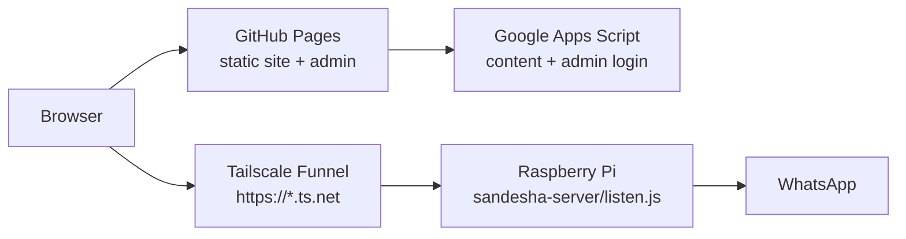
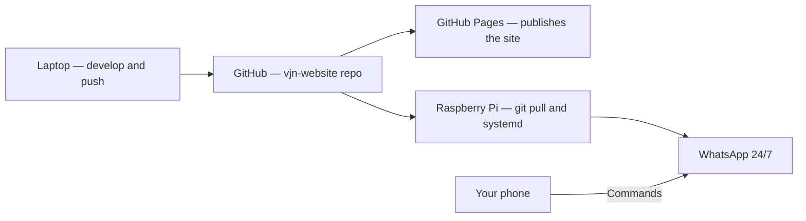

# Sandesha — Raspberry Pi Setup Guide

Run the Sandesha backend 24/7 on a Raspberry Pi at home.

Sandesha lives inside the **vjn-website** repo as `sandesha-server/`. The two halves run in different places:

| Piece | Runs on | How it is reached |
|-------|---------|-------------------|
| The website + admin pages | GitHub Pages | `https://ishavijayanagar.github.io/vjn-website/` |
| `sandesha-server/` (this folder) | Your Raspberry Pi | A Tailscale Funnel `https://*.ts.net` URL |

The browser loads the site from Pages and calls the Pi directly for anything WhatsApp-related (Promotions → Schedule/Send, Admin → Messaging). The Pi is never part of the Pages build — `_config.yml` excludes it.



> **Only one machine may hold the WhatsApp session.** Once the Pi is linked, stop the backend on your laptop for good. Two `listen.js` processes on the same WhatsApp account will fight over the session and disconnect each other.

---

## What you need

| Item | Recommendation |
|------|----------------|
| Board | **Raspberry Pi 4** (2 GB RAM minimum; 4 GB safer) or Pi 5 |
| Storage | 16 GB+ microSD (32 GB recommended) |
| Power | Official Pi power supply (avoid weak phone chargers) |
| Network | Stable home Wi‑Fi or Ethernet |
| OS | **Raspberry Pi OS Lite (64-bit)** — no desktop required |
| WhatsApp | Your phone to scan the QR code once |

Sandesha uses **Puppeteer + Chromium** for WhatsApp Web. A Pi 3 or 1 GB RAM can struggle; Pi 4 2 GB+ is the practical minimum.

---

## Checklist overview

- [ ] 1. Flash Raspberry Pi OS and boot
- [ ] 2. Update system and install Node.js 18+
- [ ] 3. Install Chromium (system browser for Puppeteer)
- [ ] 4. Clone the vjn-website repo
- [ ] 5. Install npm dependencies (skip bundled Chromium)
- [ ] 6. Create `.env` on the Pi
- [ ] 7. First run — scan WhatsApp QR
- [ ] 8. Verify bot and API
- [ ] 9. Enable `systemd` auto-start on boot
- [ ] 10. Expose it with Tailscale Funnel and point the site at the Pi
- [ ] 11. Retire the laptop backend, then updates and backups

---

## 1. Flash OS and first boot

1. Install [Raspberry Pi Imager](https://www.raspberrypi.com/software/).
2. Choose **Raspberry Pi OS Lite (64-bit)**.
3. In imager settings (gear icon):
   - Set hostname: e.g. `sandesha-pi`
   - Enable SSH (password or key)
   - Set username/password
   - Configure Wi‑Fi if not using Ethernet
4. Flash the SD card, insert into Pi, power on.

SSH from your computer:

```bash
ssh pi@sandesha-pi.local
# or: ssh pi@<PI_IP_ADDRESS>
```

---

## 2. System update and Node.js

```bash
sudo apt update && sudo apt full-upgrade -y
sudo apt install -y git curl build-essential
```

### Install Node.js 20 (recommended)

```bash
curl -fsSL https://deb.nodesource.com/setup_20.x | sudo -E bash -
sudo apt install -y nodejs
node --version   # should be v18+ 
npm --version
```

---

## 3. Install Chromium for Puppeteer

Sandesha can use system Chromium instead of downloading its own (saves ~300 MB and RAM on the Pi).

```bash
sudo apt install -y chromium-browser fonts-liberation libatk-bridge2.0-0 libgtk-3-0
```

Find the Chromium path:

```bash
which chromium || which chromium-browser
```

Typical paths:

- `/usr/bin/chromium` (Bookworm / newer)
- `/usr/bin/chromium-browser` (older images)

Set it permanently for your user:

```bash
echo 'export PUPPETEER_EXECUTABLE_PATH=/usr/bin/chromium' >> ~/.bashrc
# If `which chromium` showed chromium-browser instead, use that path.
source ~/.bashrc
```

### Optional: add swap (helps on 2 GB Pi)

```bash
sudo dphys-swapfile swapoff
sudo sed -i 's/CONF_SWAPSIZE=.*/CONF_SWAPSIZE=2048/' /etc/dphys-swapfile
sudo dphys-swapfile setup
sudo dphys-swapfile swapon
```

---

## 4. Clone the repo

The backend ships inside the website repo, so you clone the whole thing and work in the `sandesha-server/` subfolder:

```bash
mkdir -p ~/apps && cd ~/apps
git clone https://github.com/ishavijayanagar/vjn-website.git
cd vjn-website/sandesha-server
```

The repo is public, which is fine: everything sensitive (`.env`, the WhatsApp session, logs, `groups.json`) is gitignored and never leaves the machine it was created on.

---

## 5. Install dependencies

Skip Puppeteer’s bundled Chromium — use system Chromium instead:

```bash
cd ~/apps/vjn-website/sandesha-server
npm run install:no-browser
```

That is equivalent to `PUPPETEER_SKIP_DOWNLOAD=1 npm install`.

---

## 6. Create `.env` on the Pi

`.env` is gitignored, so `git clone` will not bring it over. Create it from the template:

```bash
cd ~/apps/vjn-website/sandesha-server
cp .env.example .env
nano .env
```

The values that matter on a Pi:

```env
# Required — the funnel is public, so never leave this blank
SANDESHA_ADMIN_PASSWORD=your-strong-password

# Lets the site's admin login work against Sandesha (POST /auth/vjn-exchange).
# Copy the exact URL from APPS_SCRIPT_URL in the site's ../config.js
VJN_APPS_SCRIPT_URL=https://script.google.com/macros/s/YOUR_DEPLOYMENT_ID/exec

# Stable https://*.ts.net URL
SANDESHA_TUNNEL_MODE=funnel

# Pi OS Bookworm arm64 — NOT the google-chrome path used on a laptop
PUPPETEER_EXECUTABLE_PATH=/usr/bin/chromium

# QR is more reliable than phone pairing
SANDESHA_AUTH_MODE=qr
```

Copying `.env` straight off your laptop works too, but **change `PUPPETEER_EXECUTABLE_PATH`** — the laptop value (`/usr/bin/google-chrome`) does not exist on the Pi.

### Optional extras

| File | Purpose | How to get it |
|------|---------|---------------|
| `groups.json` | Saved group sets | `scp groups.json pi@sandesha-pi.local:~/apps/vjn-website/sandesha-server/`, or rebuild in the web UI |
| `contacts.json` | Named contacts | Same, or rebuild in the UI |
| `schedules.json` | Queued messages | Copy if you have pending sends |
| `state.json` | Runtime state | Created automatically |

If auto-detecting the **Me Commands** group by name fails, pin it in `.env`:

```env
SANDESHA_COMMANDS_GROUP_JID=120363...@g.us
```

Find JIDs after the first connect with `node send.js --list`.

---

## 7. First run — link WhatsApp

Run interactively the first time (not via systemd yet):

```bash
cd ~/apps/vjn-website/sandesha-server
./sandesha.sh start
./sandesha.sh logs      # the QR / pairing code shows up here
```

This starts Sandesha in the background (and turns the public URL on if Tailscale is set up). Press `Ctrl+C` to stop watching the logs; Sandesha keeps running.

### Scan the QR code

The Pi has no screen. Use one of these:

**Option A — Terminal QR (SSH)**  
If your SSH client supports it, scan the ASCII QR shown in the terminal.

**Option B — Copy `qr-code.png` (easiest)**  
In another terminal on your laptop:

```bash
scp pi@sandesha-pi.local:~/apps/vjn-website/sandesha-server/qr-code.png .
```

Open the image on your phone, or AirDrop/share it. Then in WhatsApp:

**Settings → Linked Devices → Link a Device** and scan.

**Option C — Reset and re-scan later**

```bash
./sandesha.sh reset-whatsapp
```

Wait until you see logs like:

```
WhatsApp connected
Send server on http://127.0.0.1:42620
Setup complete!
```

Stop it with `./sandesha.sh stop` when you are done testing — next step sets up auto-start.

---

## 8. Verify

On the Pi:

```bash
# Start in background for a quick test
./sandesha.sh start
./sandesha.sh status
```

Expect `"connected":true` in the health output. WhatsApp Web takes roughly a minute to load, longer on a Pi, so do not panic at `"state":"connecting"` on the first few tries.

`/groups` returns 401 without a token — that is correct, it means auth is on.

In WhatsApp **Me Commands** group, send:

```
!help
```

You should get a reply within a few seconds.

---

## 9. Auto-start with systemd

Add Sandesha to the crontab so it starts after a reboot:

```bash
crontab -e
# add:
@reboot sleep 30 && cd ~/apps/vjn-website/sandesha-server && ./sandesha.sh start
```

Everyday commands (all in `sandesha-server/`):

```bash
./sandesha.sh status           # running? WhatsApp connected? public URL?
./sandesha.sh restart          # after pulling new code
./sandesha.sh stop
./sandesha.sh logs             # follow the output
./sandesha.sh reset-whatsapp   # forget the WhatsApp login and link a phone again
tail -f sandesha.log           # the app's own log
```

### Stale lock after crash

`./sandesha.sh start` clears a stale lock itself. If it still says it is already running:

```bash
./sandesha.sh stop
./sandesha.sh start
```

---

## 10. Publish it and point the site at the Pi

### Enable Tailscale Funnel

```bash
sudo tailscale up          # once, if the Pi is not on your tailnet yet
sudo tailscale funnel --bg 42620
tailscale funnel status
```

`--bg` persists in tailscaled's own state, so the funnel returns after a reboot without any systemd help. Your URL is the Pi's MagicDNS name, for example `https://sandesha-pi.tail2677db.ts.net`.

If Funnel is not permitted yet, enable HTTPS certificates and the `funnel` node attribute in the Tailscale admin console — see [docs/DEPLOY_FUNNEL.md](docs/DEPLOY_FUNNEL.md).

Check it from another network:

```bash
curl https://sandesha-pi.tail2677db.ts.net/health
```

### Update the site's config.js

**This is the step people miss.** The published site reads the API URL from `config.js` at the repo root, and that file is baked into the GitHub Pages build. The Pi's funnel hostname differs from your laptop's, so the site must be updated and pushed:

```bash
cd ~/apps/vjn-website
nano config.js     # set SANDESHA_API_URL to the Pi's https://*.ts.net URL
git commit -am "Point Sandesha API at the Raspberry Pi"
git push
```

Pages redeploys in a minute or two after you push.

As a stopgap you can override the URL per-browser with the gear icon on the Promotions page, which writes to `localStorage` — handy for testing before you push.

---

## 11. Retire the laptop backend

With the Pi live, stop the old one so the two do not fight over the WhatsApp session:

```bash
# On the laptop
pkill -f 'listen[.]js'
tailscale funnel --https=443 off     # release the laptop's funnel
```

### Updating from GitHub

```bash
cd ~/apps/vjn-website
sudo systemctl stop sandesha
git pull
cd sandesha-server && npm run install:no-browser
sudo systemctl start sandesha
```

Because the site and the backend are one repo now, `git pull` on the Pi also pulls website changes. That is harmless — the Pi only ever runs `sandesha-server/`.

**Do not** delete `.wwebjs_auth/` during updates — that would force a new QR scan.

### Back up the session

```bash
# From your laptop, keeps a copy of the WhatsApp link
ssh pi@sandesha-pi.local 'tar -czf - -C ~/apps/vjn-website/sandesha-server .wwebjs_auth' > wwebjs_auth-backup.tar.gz
```

---

## What belongs in `.gitignore` (never push to GitHub)

These rules live in [`.gitignore`](.gitignore) **inside this folder**, deliberately scoped to the backend so they cannot accidentally exclude website assets in the parent repo. The website repo is public, so this file is the thing standing between your WhatsApp session and the internet — do not weaken it.

| Path | Why |
|------|-----|
| `.wwebjs_auth/` | WhatsApp session — anyone with this can use your account |
| `.wwebjs_cache/` | Browser cache tied to session |
| `.baileys_auth/` | Alternate auth store |
| `groups.json` | Your group JIDs (private) |
| `schedules.json` | Your scheduled messages |
| `contacts.json` | Personal contacts |
| `state.json` | Runtime state |
| `.lock` | Process lock (runtime only) |
| `*.log`, `notifications.log` | Activity logs |
| `qr-code.png` | QR used to link device |
| `media/` | Downloaded/sent media |
| `.env` | API keys and secrets |
| `node_modules/` | Dependencies (reinstall on Pi) |

Verify at any time from the repo root:

```bash
cd ~/apps/vjn-website
git check-ignore -v sandesha-server/.env sandesha-server/.wwebjs_auth sandesha-server/sandesha.log
git status --short          # nothing sensitive should appear here
```

Each path should print the rule that ignores it. If one prints nothing, stop and fix it before committing.

### Safe to commit

- Source code (`listen.js`, `send.js`, `settings.js`, `scripts/`)
- The guides, `.env.example`, and `sandesha.sh`

---

## Accessing the API from other devices (optional)

By default the HTTP API binds to `127.0.0.1` (Pi only).

### SSH tunnel (private, no Cloudflare)

```bash
ssh -L 42620:127.0.0.1:42620 pi@sandesha-pi.local
```

Then open **http://127.0.0.1:42620/** on your laptop.

### Public HTTPS for the GitHub Pages site

Covered in step 10 — Tailscale Funnel is the supported path. [docs/DEPLOY_CLOUDFLARE.md](docs/DEPLOY_CLOUDFLARE.md) remains if you would rather run a Cloudflare named tunnel on your own domain; in that case set `SANDESHA_TUNNEL_MODE=named` and put the hostname in `SANDESHA_PUBLIC_URL`.

Either way the API requires a Bearer token, so **never expose it without `SANDESHA_ADMIN_PASSWORD` set** in `.env`.

> Older notes told you to serve the dashboard from the `/docs` folder via GitHub Pages. That no longer applies. Pages now serves the **repo root** (the VJN website), and `sandesha-server/docs/` is just a redirect notice plus icons for the local dashboard.

---

## Troubleshooting (Pi-specific)

| Problem | Fix |
|---------|-----|
| Chromium fails to start | Confirm `PUPPETEER_EXECUTABLE_PATH`, run `chromium --version` |
| Out of memory / killed | Add swap (step 3), use Pi 4 2 GB+, close other services |
| Session drops often | Use Ethernet; avoid Pi undervoltage (check `vcgencmd get_throttled`) |
| QR expired | `./sandesha.sh reset-whatsapp` and scan again quickly |
| `Bot is already running` | `rm -f .lock`, run `./sandesha.sh stop`, and make sure no old systemd service or manual process is running |
| Repeated random disconnects | The laptop backend is probably still running — only one machine may hold the session |
| Site works but Schedule/Send fail | `config.js` still points at the old URL; update and push, or set the gear-icon override |
| Funnel gone after reboot | `sudo tailscale funnel --bg 42620` (the `--bg` form is what persists) |
| Schedule missed during outage | Bot only fires while running — use `systemd` + UPS optional |
| After power cut | systemd should auto-start; re-scan only if session corrupted |

Check Pi health:

```bash
vcgencmd get_throttled   # 0x0 = OK; non-zero = power/thermal issues
free -h
df -h
```

---

## GitHub + Pi workflow (summary)



1. **GitHub** — one repo holds both the site and the backend
2. **GitHub Pages** — rebuilds the site on push; `sandesha-server/` is excluded
3. **Raspberry Pi** — `git pull`, runs `listen.js` 24/7 via systemd, exposed by Tailscale Funnel
4. **Phone** — scan QR once; send commands in the Me Commands group

Remember that a change to the Pi's public URL means editing `config.js` and pushing, because the browser gets that value from Pages, not from the Pi.

---

## Quick reference

```bash
cd ~/apps/vjn-website/sandesha-server

./sandesha.sh start | stop | restart | status | logs
./sandesha.sh reset-whatsapp        # re-link WhatsApp (scan the QR / enter the code again)

# Logs
tail -f sandesha.log

# Health (local, then public)
curl http://127.0.0.1:42620/health
curl https://sandesha-vjn-pi.tail2677db.ts.net/health

# Funnel
tailscale funnel status
sudo tailscale funnel --bg 42620
```
